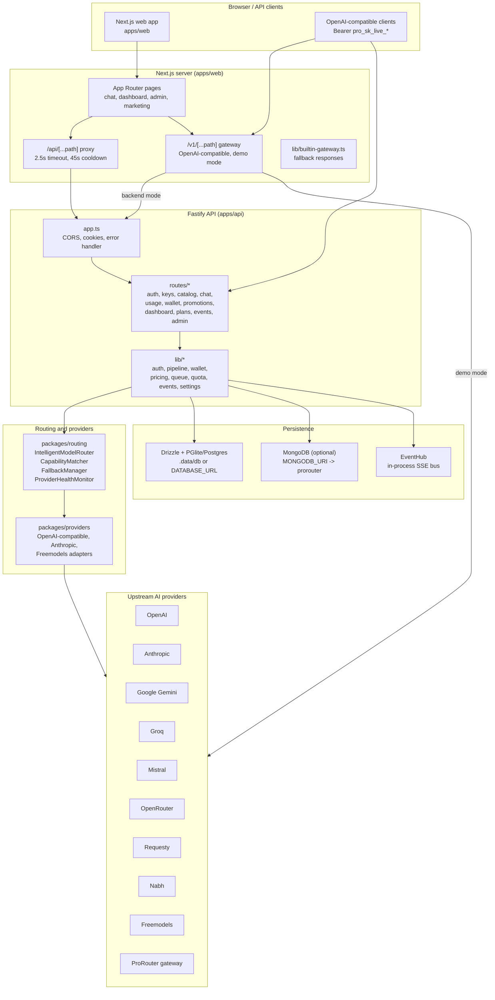
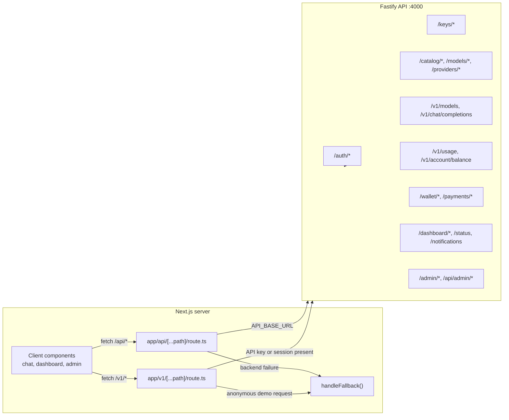

# 02 — System Architecture

## 1. High-level architecture



Key characteristics:

- The Fastify API is the **system of record** for auth, wallets, API keys, usage, and catalog data.
- The Next.js `/v1` gateway is a **second, independent OpenAI-compatible surface**, capable of operating without the Fastify API when demo mode is active.
- The routing engine is a library, not a service; it runs in-process inside Fastify requests and inside the Next.js gateway's backend-proxy paths.
- MongoDB, when enabled, is intended as a primary store; the SQL path remains available.

## 2. Frontend–backend boundaries



Boundary rules observed in code:

1. `/api/[...path]` **always proxies to the backend** (except localhost self-references) and only falls back after timeout/connection failure. It forwards cookies and uses `safeForwardHeaders`.
2. `/v1/[...path]` selects its mode per request: with a valid API key (`Authorization: Bearer pro_sk_...`) or `uno_session` cookie it proxies to the backend; otherwise it enters the local/demo path using built-in provider credentials.
3. The web app never talks to the database directly; all data access is through API routes or server-side fetches.

## 3. Monorepo layout

```
my router/
├─ apps/
│  ├─ api/                  Fastify server
│  │  ├─ src/app.ts         plugins, CORS, error handler, route registration
│  │  ├─ src/server.ts      bootstrap (migrate + seed in background)
│  │  ├─ src/lib/           auth, request-auth, pipeline, wallet, pricing,
│  │  │                     queue, ratelimit, freequota, events, settings, catalog
│  │  └─ src/routes/        auth, keys, catalog, chat, usage, wallet,
│  │                        promotions, dashboard, plans, events, admin
│  └─ web/                  Next.js 16 app
│     ├─ app/api/[...path]/route.ts    backend proxy with builtin fallback
│     ├─ app/v1/[...path]/route.ts     OpenAI-compatible gateway (demo + backend)
│     ├─ app/(pages)/...              chat, dashboard, admin, marketing
│     └─ lib/builtin-gateway.ts
├─ packages/
│  ├─ shared/               env, errors, money, pricing-engine, crypto,
│  │                        password, persona, DTO types
│  ├─ database/             Drizzle schema, migrations, seed, catalog-aliases,
│  │                        store contract, Mongo client/collections/indexes
│  ├─ routing/              router, capability matcher, health monitor,
│  │                        fallback manager, catalog generator
│  └─ providers/            provider adapters + registry
├─ scripts/                 build, start, providers, probes, cleanup, sync
├─ tests/                   13 test files
└─ docs/                    existing reports + this analysis
```

## 4. Architectural assessment

| Concern | Assessment | Status |
|---|---|---|
| Separation between web and API | Clear: web is a client/proxy, API owns state | FULLY IMPLEMENTED |
| Single source of truth for billing | Fastify API | FULLY IMPLEMENTED |
| Single source of truth for chat | Split: Fastify `/v1/chat/completions` and Next.js `/v1/[...path]` demo mode | PARTIALLY IMPLEMENTED |
| Storage portability | `DataStore` contract exists; implementations not found in `src` glob | NEEDS VERIFICATION |
| Event delivery | In-process `EventHub`; SSE heartbeat 15 s, 100-event replay buffer | FULLY IMPLEMENTED (single instance) |
| Horizontal scaling | In-memory rate limits, quotas, event bus, and key-pool rotation state prevent naive multi-instance deployment | PARTIALLY IMPLEMENTED |
| Provider abstraction | Registry + adapters; some adapters only support chat completions | PARTIALLY IMPLEMENTED |
| Frontend error resilience | Proxy cooldown + builtin fallback returns model-shaped responses | CONFIGURED BUT NOT CONNECTED to billing |

## 5. Deployment shape implied by code

- `npm run build` → `scripts/build.mjs`; production start → `scripts/start-prod.mjs`.
- API and web are deployed as separate Node processes; `API_BASE_URL` is the only required link.
- The web app's `/v1` gateway can run on serverless (it sets `maxDuration = 60`) but uses module-level mutable state for free-playground counters and key rotation, which is unreliable across serverless instances.
- CORS allowlist includes `prorouter.in`, localhost ports 3000/3100/4000/4100, `*.vercel.app`, and `*.onrender.com`.

## 6. What is not present

- No message queue or job runner for async billing/payment reconciliation.
- No Redis integration in the default path (the rate limiter mentions Redis-swappability but ships an in-memory store).
- No API gateway-level request signing between web and API; they rely on cookies/headers.
- No dedicated admin service; admin endpoints live in the same Fastify process.
