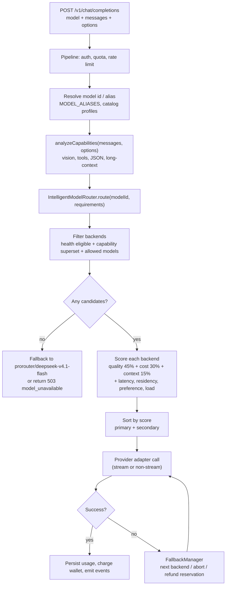

# 03 — Routing Engine

## 1. Components

| Component | File | Responsibility |
|---|---|---|
| Backend registry | `packages/routing/src/backend-registry.ts` | Static inventory of upstream backends (id, provider, model, context, max output, paise cost per 1M, capabilities, free flag, weight, status) |
| Intelligent router | `packages/routing/src/intelligent-router.ts` | Scores eligible backends and returns a primary/secondary decision |
| Capability matcher | `packages/routing/src/capability-matcher.ts` | Extracts required capability flags from request content |
| Provider health monitor | `packages/routing/src/provider-health-monitor.ts` | Tracks success/failure, latency, circuit-breaker cooldowns |
| Fallback manager | `packages/routing/src/fallback-manager.ts` | Retries the next backend; handles mid-stream aborts and safety refusals |
| Model behavior engine | `packages/routing/src/model-behavior.ts` | Per-profile behavior hints (reasoning style, verbosity, tool usage) |
| Model profile registry | `packages/routing/src/model-profiles.ts` | Runtime profile metadata lookup |
| Catalog service | `packages/routing/src/model-catalog.ts` | Resolves model ids/aliases to registry and catalog rows |
| Catalog generator | `packages/routing/src/catalog-generator.ts` | Generates 500+ synthetic frontend profiles with routing policies |

## 2. Routing flow

## 3. Backend registry facts

From `backend-registry.ts` and the catalog generator:

- Only **two backends are marked free** in the launch registry:
  - `prorouter/deepseek-v4.1-flash` (provider `prorouter`, canonical `deepseek-v4.1-flash`)
  - `groq/qwen3.8-27b` (provider `groq`)
- Costs are stored as **integer paise per 1M tokens** (USD × ₹80 × 100). Verified entries include:
  - `deepseek-v4.1-flash`: input 1120 paise, output 2240 paise (≈ $0.14 / $0.28 per 1M at ₹80).
  - `qwen3.8-27b`: input 1600 paise, output 6400 paise (≈ $0.20 / $0.80).
- Additional registry entries cover GPT OSS 20B/120B, Nemotron variants, Gemma 4, Leanstral, Ling, Allam, Claude/GPT/Gemini families (the latter are display/routing identities, not necessarily distinct upstreams).
- Every backend carries a `capabilities` map with values `supported | unsupported | unknown`.

## 4. Scoring model

Documented weights in `intelligent-router.ts`:

| Factor | Weight / rule |
|---|---|
| Quality | 0.45 baseline contribution; +0.15 when backend model matches requested model, +0.10 provider tier bonus, +0.12 free bonus |
| Cost efficiency | 0.30; `1 − normalizedCost`, where cost is blended input/output paise |
| Context fit | 0.15; 0.55 × (backend context / required context), capped |
| Data residency | +0.05 for matching preference |
| User preference | +0.30 when the backend is in the user's preferred list |
| Latency | `1 − p95/5000`, bounded |
| Load health | Deducts for recent request volume/error pressure |

Eligibility gates run before scoring: unknown/unavailable health status, missing capability flags, and `allowedModels` restrictions eliminate candidates. The router returns `{ backend, score, reasoning }` with a secondary backend when available.

## 5. Capability analysis

`analyzeCapabilities` inspects message content and request options:

- Image/document parts in messages → `vision`.
- `tools` or `tool_choice` present → `tool_calling`.
- `response_format.type === "json_object"` or JSON schema hints → `json_structured`.
- Very large payloads/context → long-context requirements.
- Unknown content falls back to `general_intelligence`.

This drives both the eligibility filter and the routing reason string. Exact heuristics (regexes, thresholds) are in `capability-matcher.ts` and should be treated as implementation detail rather than policy.

## 6. Scoring versus billing

Routing cost inputs and customer pricing are separate:

- Registry costs (paise/1M) feed **scoring** and **upstream cost accounting**.
- Customer charges come from `models.pricing` rows (input/output/cached paise per 1M), seeded from `PRICING_TIER_SEEDS` and converted by `pricing-engine`.
- Because of this split, a cheap backend can still be sold at a profile's tier price; the difference is platform margin.

## 7. Generated catalog policy

`catalog-generator.ts` builds profiles in 12 categories (general 70, reasoning 65, coding 85, agentic 45, vision, multilingual, fast, creative, education, business, science, and legacy families). Observations:

- Every generated profile is `pricingStatus: "approved"` and `isFree: false`.
- Generated routing policies specify a primary backend, secondary backend, and `finalFallback: "prorouter/deepseek-v4.1-flash"`.
- Many profiles share the same upstreams (`prorouter/deepseek-v4.1-flash`, `groq/qwen3.8-27b`, `requesty/nemotron-3-ultra-550b-a55b`, `groq/gpt-oss-120b`).
- The `behavior.system_prompt_template` for verified models says "You are {name}. Provide authentic, direct responses without claiming unverified capabilities" — in tension with the persona layer in `packages/shared/src/persona.ts`, which does the opposite.
- Legacy catalog models are marked paid and routed generically.

## 8. Health and fallback semantics

- Health keys are `${provider}:${backendId}` in the monitor's `getOrCreate` path.
- Suspected defect: `isAvailable(id)` derives provider and backend from the same single string, so callers that pass a bare backend id will not match health entries created with a compound key. Treat as **NEEDS VERIFICATION** until a focused unit test or trace confirms.
- On stream failure after tokens have been emitted, the fallback manager aborts with `abort_error` rather than replaying the request (avoids duplicated output).
- On safety/policy refusals, it preserves the refusal (`preserve_refusal`) instead of silently switching models.

## 9. Status

| Capability | Status |
|---|---|
| Deterministic scoring and eligibility | FULLY IMPLEMENTED |
| Static backend registry | FULLY IMPLEMENTED |
| Health-aware fallback | PARTIALLY IMPLEMENTED (key mismatch suspected) |
| Capability extraction | PARTIALLY IMPLEMENTED (heuristic, not schema-validated) |
| Dynamic provider discovery | NOT IMPLEMENTED (registry is static code) |
| Learned/cost-based routing across real upstream prices | PARTIALLY IMPLEMENTED (cost table static, not synced) |
| Generated 500+ profile catalog | FULLY IMPLEMENTED as data generation; identities are synthetic |
