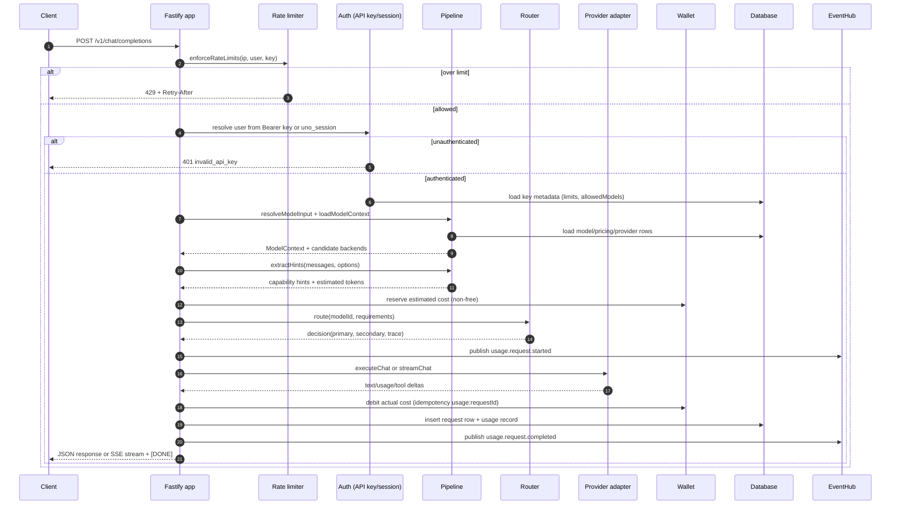

# 05 — Request Lifecycle

This document traces a single `POST /v1/chat/completions` request through the Fastify API. The flow is reconstructed from `apps/api/src/routes/chat.ts` and `apps/api/src/lib/pipeline.ts` (the latter was partially truncated; stages marked **NEEDS VERIFICATION** are inferred from its exports and call sites).

## 1. End-to-end sequence

## 2. Stage detail

### 2.1 CORS and parsing

- `app.ts` registers `@fastify/cors` with an explicit origin allowlist and `credentials: true`, then `@fastify/cookie` with `env.authSecret`.
- JSON bodies are parsed by Fastify defaults. Zod schemas in `chat.ts` validate `model`, `messages`, `stream`, `temperature`, `max_tokens`, `tools`, `tool_choice`, and `parallel_tool_calls`.

### 2.2 Authentication

- `request-auth.ts` resolves the caller in this order: `Authorization: Bearer` API key, then `uno_session` cookie.
- API keys are looked up by SHA-256 hash, checked for revocation, expiry, and optional spend limit. Keys can carry `allowedModels`, enforced later by the router.
- Sessions are opaque tokens hashed at rest and joined to users.

### 2.3 Rate limiting and quotas

- `ratelimit.ts` applies three sliding windows: IP 120/min, user 60/min, API key 60/min. State is in-memory; `REDIS_URL` is mentioned as a future swap.
- Free models additionally pass the free-quota gate (`freequota.ts`), which performs an atomic `INSERT ... ON CONFLICT DO UPDATE ... RETURNING` on `free_usage` for minute/hour/day buckets.
- Free-model requests may wait in a priority queue derived from `plans.queue_priority`; the wait is reported as `queueWaitMs`.

### 2.4 Model resolution

- `resolveModelInput` normalizes aliases (`MODEL_ALIASES`) and slug variants.
- `loadModelContext` loads the model row, pricing, capabilities, provider links, and catalog profile.
- Models with `pricingStatus: "pricing_pending"` are rejected with a policy error until an admin approves pricing (verified in `chat.ts` around line 168).
- `resolveAutoModel` handles `model: "auto"` selection.
- `hydrateCandidates` and `extractHints` build routing requirements: vision, tools, JSON, context length.

### 2.5 Reservation and routing

- For non-free models, the wallet is reserved against the estimated token cost before the upstream call. The estimate is derived from a local tokenizer or heuristic.
- `IntelligentModelRouter.route` returns a `decision` with `primary`, optional `secondary`, and `trace` (eligibility/scoring reasons). The trace is returned to clients in the `uno` metadata block.
- `decision.primary.upstreamModelId` is what the adapter sends upstream — not the customer-facing model id.

### 2.6 Upstream execution

- `executeChat` handles non-streaming requests and returns `{ content, toolCalls, usage, usageSource, providerId, providerSlug }`.
- `streamChat` yields typed events: `content` deltas, `tool_call_delta`, `usage`, and completion. `chat.ts` maps these to OpenAI `chat.completion.chunk` objects.
- Client disconnects abort the upstream call (`request.signal`).

### 2.7 Finalization

`finalize()` in `chat.ts` performs, in order:

1. Determines `usageSource` (`upstream | estimated | none`).
2. Bills only when `usageSource === "upstream"` or `BILL_ESTIMATED_USAGE` is enabled and there is token usage; free models skip billing.
3. Computes cost from model pricing (`calculateTokenPrice` → paise).
4. Debits the wallet with idempotency key `usage:<requestId>` and releases/consumes the reservation.
5. Updates Astra promotional activation progress (token-based campaign) when active.
6. Inserts a `requests` row with denormalized usage fields (`prompt/completion/total tokens`, `costPaise`, `status`, `httpStatus`, `errorCode`, `ttftMs`, `usageSource`).
7. Publishes `usage.request.completed` or `usage.request.failed` to `EventHub`.

### 2.8 Response shapes

- Non-streaming: OpenAI `chat.completion` with `choices[0].message` (including `tool_calls` when present), `usage`, and an `uno` extension field containing `request_id`, provider, cost, free flag, queue wait, routing trace, and usage source.
- Streaming: SSE with `data:` chunks and an `uno` block on the final usage chunk; ends with `data: [DONE]\n\n`.
- Response header `x-prorouter-usage-source` is set for non-streaming calls.

## 3. Failure modes

| Failure | Behavior |
|---|---|
| Invalid/expired API key | 401, no billing |
| Rate limit exceeded | 429 + `Retry-After` |
| Pricing pending | 400/403 policy error before provider call |
| No eligible backend | Router returns 503-style `model_unavailable` (or final fallback) |
| Provider HTTP/stream error | Fallback to secondary when no tokens sent; else `abort_error`; request row marked error |
| Client disconnect | Upstream aborted; request row status error with 499 |
| Zero-token stream | Usage estimated from messages/completion; billing only if estimate billing flag enabled |
| Wallet insufficient | Rejected before upstream call |

## 4. Lifecycle observations

- Billing is **post-hoc** for streams: the reservation is an estimate, the debit uses actual usage. This is correct but means reservation size must be conservative.
- `usageSource: "estimated"` is not billed by default, so upstreams that omit usage are effectively free unless `BILL_ESTIMATED_USAGE` is on.
- The `requests`/`usage` write happens after the wallet debit; a crash between them could produce a debit without a usage row. Idempotency protects against double-charging but not against missing analytics.
- `ModelContext` enforces `allowedModels` from the API key at pipeline level (verified by the presence of key restrictions in the DTO and router requirements).

## 5. Status

| Stage | Status |
|---|---|
| Auth, rate limiting, quota | FULLY IMPLEMENTED (single-instance state) |
| Alias/model resolution | FULLY IMPLEMENTED |
| Wallet reservation + idempotent debit | FULLY IMPLEMENTED |
| Routing trace exposure | FULLY IMPLEMENTED |
| Async billing reconciliation | NOT IMPLEMENTED |
| Durable request queue | NOT IMPLEMENTED |
| Multi-instance-safe rate/quota state | PARTIALLY IMPLEMENTED |
