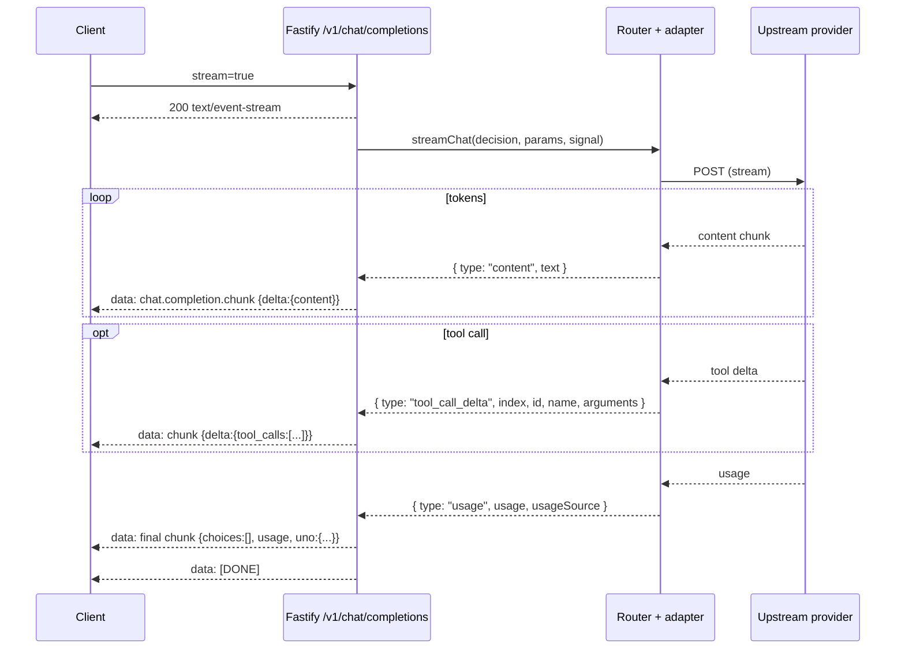

# 06 — Streaming and Tool Calls

## 1. Streaming protocol

The Fastify API implements OpenAI-compatible Server-Sent Events for `POST /v1/chat/completions` with `"stream": true`.

Verified headers and framing (`apps/api/src/routes/chat.ts`):

- `Content-Type: text/event-stream; charset=utf-8`
- `Cache-Control: no-cache`
- `Connection: keep-alive` (with `X-Accel-Buffering: no` for proxy compatibility)
- Each event: `data: <JSON>\n\n`
- Terminator: `data: [DONE]\n\n`



Chunk shape (abridged):

```json
{
  "id": "chatcmpl_...",
  "object": "chat.completion.chunk",
  "created": 1700000000,
  "model": "customer/model-id",
  "choices": [
    { "index": 0, "delta": { "content": "..." }, "finish_reason": null }
  ]
}
```

Final usage chunk adds:

```json
{
  "choices": [],
  "usage": { "prompt_tokens": 0, "completion_tokens": 0, "total_tokens": 0 },
  "uno": {
    "request_id": "...",
    "provider": "...",
    "cost_paise": 0,
    "is_free": false,
    "queue_wait_ms": 0,
    "route": { "...": "routing trace" },
    "usage_source": "upstream"
  }
}
```

## 2. Stream failure semantics

- If the upstream fails **before any token** is emitted, the fallback manager may switch to the secondary backend and restart the stream cleanly.
- If the upstream fails **after tokens were sent**, the router aborts (`abort_error`) rather than replaying and duplicating output.
- Safety/policy refusals are preserved (`preserve_refusal`); the router does not silently switch to a more permissive model.
- Mid-stream errors are emitted as `data: {"error": {...}}\n\n` followed by `[DONE]`.
- Client disconnects abort via `request.signal` and finalize the request as `client_aborted` with HTTP 499 in analytics.
- If the stream ends with zero tokens, usage is estimated from the prompt and accumulated content; `usageSource` becomes `estimated`.

## 3. Tool calls

### 3.1 Pass-through model

The router does **not** execute tools. It forwards:

- `tools` — array of tool definitions (validated as `unknown[]`).
- `tool_choice` — provider-specific selector.
- `parallel_tool_calls` — boolean pass-through.

Upstream tool-call deltas are mapped to OpenAI streaming format:

```
{ "type": "tool_call_delta", "index": 0, "id": "call_...", "name": "get_weather", "arguments": "{\"city\":\"" }
```

Each event becomes a `choices[0].delta.tool_calls[]` entry with `index`, `id`, `type: "function"`, and `function.name` / `function.arguments`. Non-streaming responses attach `message.tool_calls` directly. This matches OpenAI's incremental tool-argument convention.

### 3.2 What is verified

| Behavior | Evidence |
|---|---|
| `tools`, `tool_choice`, `parallel_tool_calls` accepted | `chat.ts` request schema lines 28–30 |
| Tool deltas streamed in OpenAI format | `chat.ts` lines 513–515 |
| Tool calls included in non-streaming response | `chat.ts` line 433 |
| Adapter forwards tool options | `chat.ts` lines 294–296 |
| Server-side tool execution loop | Not found |
| Tool result ingestion / multi-turn agent loop | Not implemented in the router |

### 3.3 Tool-call limitations

- There is no server-side tool executor, so "agentic" behavior depends entirely on the client implementing the tool loop.
- Some adapters may not support tools; the capability matcher filters candidates only when it detects tool usage in the request, but adapter-level rejections surface as upstream errors.
- Tool-call arguments are passed unvalidated; schema enforcement is the client's/provider's responsibility.
- If an upstream emits tool calls without usage, billing falls back to `estimated`/`none` behavior described above.

## 4. Client compatibility

The `apps/web` chat UI consumes the same streaming endpoint. The Next.js `/v1` gateway also streams, but in demo mode it may synthesize or proxy upstream streams depending on the selected backend. Exact demo-mode stream transformations are **NEEDS VERIFICATION** (the gateway file was only partially inspected).

## 5. Operational notes

- SSE responses are not buffered by Fastify, but any reverse proxy must disable buffering (`X-Accel-Buffering: no` is sent).
- The event stream holds a connection for the duration of generation; serverless deployments must respect platform timeouts (web gateway sets `maxDuration = 60`).
- No per-stream keepalive is emitted for chat completions; long silences from an upstream can hit intermediary idle timeouts. Dashboard SSE (`/dashboard/events`) does send 15-second heartbeats.

## 6. Status

| Capability | Status |
|---|---|
| OpenAI-compatible streaming | FULLY IMPLEMENTED |
| Incremental tool-call deltas | FULLY IMPLEMENTED (pass-through) |
| Tool execution / agent runtime | NOT IMPLEMENTED |
| Mid-stream failover | PARTIALLY IMPLEMENTED (abort-safe, not replay) |
| Stream usage accounting | FULLY IMPLEMENTED with estimated fallback |
| Multi-instance SSE fan-out | NOT IMPLEMENTED (in-process EventHub) |
