# 07 — Database Schema

Schema source: `packages/database/src/schema/*.ts` (Drizzle ORM, PostgreSQL dialect, PGlite-compatible). **44 tables** were found across five schema modules.

## 1. Entity-relationship overview

```mermaid
erDiagram
    users ||--o{ sessions : "has"
    users ||--o{ apiKeys : "owns"
    users ||--|| wallets : "has one"
    users ||--o{ requests : "makes"
    users ||--o{ payments : "pays"
    users ||--o{ subscriptions : "subscribes"
    users ||--o{ notifications : "receives"
    users ||--o{ conversations : "owns"
    users ||--o{ astraEntitlements : "earns"
    users ||--o{ promotionalActivations : "activates"

    plans ||--o{ subscriptions : "defines"
    creditPackages ||--o{ payments : "purchased as"
    wallets ||--o{ walletTransactions : "ledger"
    wallets ||--o{ walletReservations : "holds"
    requests ||--o{ requestAttempts : "retries"

    providers ||--|| providerCredentials : "encrypted keys"
    providers ||--|| providerHealth : "status"
    providers ||--o{ providerCosts : "cost table"
    providers ||--o{ modelProviders : "serves"
    models ||--o{ modelProviders : "offered by"
    models ||--|| modelPricing : "price"
    models ||--|| modelCapabilities : "capabilities"
    models ||--|| modelLimits : "limits"
    models ||--o{ modelAliases : "aliases"
    models ||--o{ requests : "targeted"

    pricingTiers ||--o{ models : "tier"
    pricingVersions ||--o{ modelPricing : "history"
    conversations ||--o{ messages : "contains"

    astraCampaigns ||--o{ giftCodes : "issues"
    giftCodes ||--o{ giftCodeRedemptions : "redeemed"
    astraCampaigns ||--o{ astraEntitlements : "grants"
    astraCampaigns ||--o{ promotionalActivations : "tracks"
```

## 2. Tables by module

### 2.1 Auth (`schema/auth.ts`)

| Table | Purpose | Notable columns |
|---|---|---|
| `users` | Accounts | id (uuid), email (unique), passwordHash, role, name, accountNumber, createdAt |
| `sessions` | Opaque login sessions | id, userId FK, tokenHash (unique), expiresAt, createdAt |
| `api_keys` | Programmatic credentials | id, userId FK, name, prefix, keyHash (unique), expiresAt, revokedAt, lastUsedAt, requestCount, spendPaise, spendingLimitPaise, allowedModels |

### 2.2 Billing (`schema/billing.ts`)

| Table | Purpose | Notable columns |
|---|---|---|
| `wallets` | One per user | userId (PK/FK), balancePaise, reservedPaise, lifetimeTopupPaise, lifetimeSpendPaise |
| `wallet_transactions` | Immutable ledger | id, userId, type (`topup/refund/promotional/gift/usage/adjustment`), amountPaise, balanceAfterPaise, reference, idempotencyKey (unique per user), metadata |
| `wallet_reservations` | Pre-auth holds | id, userId, requestId, amountPaise, status, expiresAt |
| `credit_packages` | Purchasable bundles | id, slug (unique), name, pricePaise, creditPaise, bonusPaise, active |
| `plans` | Subscription tiers | id, slug, name, monthlyPricePaise, queuePriority, limits |
| `subscriptions` | User plan state | id, userId, planId, status, periodStart/End |
| `payments` | Gateway orders | id, userId, packageId, gateway, gatewayOrderId, amountPaise, status, metadata |
| `payment_webhooks` | Webhook event log | id, gateway, eventId, payload, processedAt (idempotency) |

### 2.3 Catalog (`schema/catalog.ts`)

| Table | Purpose |
|---|---|
| `providers` | Provider registry rows (slug, name, baseUrl, status, priority) |
| `provider_credentials` | Encrypted API keys/config per provider (AES-256-GCM) |
| `provider_health` | Health state, last check, latency, error |
| `pricing_tiers` | lite/flash/standard/code/reason/expert price bands |
| `models` | Customer-facing models (slug, name, category, status, context, max output, pricingStatus, isFree, rank) |
| `model_pricing` | Input/output/cached paise per 1M, currency, effective dates |
| `model_capabilities` | Capability flags (vision, tools, JSON, reasoning, etc.) |
| `model_providers` | M:N model↔provider links with upstream model id and priority |
| `model_limits` | Rate/token limits per model |
| `routing_rules` | Model-specific routing overrides |
| `model_aliases` | Alias → canonical model mapping |
| `provider_costs` | Upstream cost table per provider/model |
| `pricing_versions` | Price history/versioning |
| `pricing_audit_logs` | Admin pricing changes |
| `pricing_sync_logs` | External price-sync runs |
| `exchange_rates` | USD→INR and other pairs |

### 2.4 Promotions (`schema/promotions.ts`)

| Table | Purpose |
|---|---|
| `astra_campaigns` | Campaign config (rewards, dates, token milestones) |
| `gift_codes` | Redeemable codes (code hash, value, expiry, max uses) |
| `gift_code_redemptions` | Redemption records |
| `astra_entitlements` | Per-user earned entitlements |
| `promotional_activations` | Per-user campaign activation/progress |

### 2.5 Requests and conversations (`schema/requests.ts`)

| Table | Purpose |
|---|---|
| `requests` | One row per completion request; **usage fields are denormalized here** (prompt/completion/total tokens, costPaise, isFree, streaming, status, errorCode, ttftMs, usageSource) |
| `request_attempts` | Per-backend attempts (provider, backend id, latency, error) |
| `free_usage` | Atomic minute/hour/day counters for free models |
| `conversations` | Chat UI conversation metadata |
| `messages` | Chat messages (role, content, tool calls) |

### 2.6 Platform (`schema/platform.ts`)

| Table | Purpose |
|---|---|
| `system_settings` | Key/value runtime settings (rates, flags, limits) |
| `feature_flags` | Boolean rollout flags |
| `audit_logs` | Admin/user action audit trail (actorUserId, action, target, metadata) |
| `notifications` | In-app notifications |
| `notification_prefs` | Per-user channel preferences |
| `incidents` | Status-page incidents |
| `email_log` | Outbound email log |

## 3. Persistence modes

- **SQL (default):** embedded PGlite persisted under `.data/db` (`DATABASE_DIR`). Suitable for a single-process deployment only.
- **External PostgreSQL:** enabled by `DATABASE_URL` (Drizzle node-postgres driver).
- **MongoDB (optional):** `MONGODB_URI` enables a Mongo primary store (`MONGODB_DB=prorouter`). Collection names mirror SQL table names 1:1. `migrate.ts` performs a one-time snake_case→camelCase copy; `_id` is a uuid string except for one-to-one collections (`userId`/`modelId`/settings key). Indexes are created idempotently by `ensureIndexes`.
- **Dual-store contract:** `store/types.ts` declares a `DataStore` interface and references `sql-store.ts` and `mongo-store.ts`. Those implementation files were not returned by the `packages/database/src/**/*.ts` glob in this review — **NEEDS VERIFICATION**.

## 4. Indexes and constraints (verified in SQL schema and Mongo indexer)

- `users.email` unique.
- `api_keys.key_hash` unique; `(user_id, created_at)` for listing; prefix lookup.
- `sessions.token_hash` unique; `(user_id, expires_at)`; TTL cleanup expected via expiry checks.
- `wallet_transactions` idempotency key unique (partial, where not null).
- `free_usage` composite unique on user/model/bucket.
- `credit_packages.slug` unique.
- Mongo equivalents: `users_email_uq`, `sessions_token_uq`, `api_keys_hash_uq`, `wallet_tx_idem_uq`, plus role/createdAt indexes.

## 5. Seed data

`seedDatabase()` inserts/upserts:

- System settings including `USD_TO_INR_RATE` (97 in production, 80 otherwise) and `USD_TO_INR_MARKET_RATE` (88).
- Pricing tiers from `PRICING_TIER_SEEDS`; plans; credit packages; feature flags.
- Providers and encrypted provider credentials.
- Models, pricing, capabilities, limits, provider links, aliases.
- Exchange rates, provider costs, pricing versions.
- Astra campaign rows and test/demo users/wallets.

Seeding is idempotent via `onConflictDoNothing`, but it runs asynchronously after the server starts listening, so early requests may observe a partially seeded catalog.

## 6. Data-integrity observations

1. **Ledger vs. balance:** balances are cached in `wallets` and reconstructed via `wallet_transactions`. Correctness depends on every mutation path using transactions and idempotency keys. The code does so in billing paths; admin wallet adjustments must be reviewed (truncated admin reads).
2. **Usage denormalization:** `requests` carries usage and cost. This simplifies dashboards but duplicates pricing logic; a pricing change does not rewrite historical rows (desirable) unless a sync job does.
3. **Currency drift:** three different USD→INR rates exist (97/88/80). Charges, market displays, and pricing-engine displays can disagree.
4. **Promotions:** `promotional_activations` exists in the schema; a subagent claim that its migration is missing is **unverified** and likely stale.
5. **Mongo migration:** the copy is one-time and manual (`npm run db:migrate:mongo`), with no continuous dual-write reconciliation found.

## 7. Status

| Capability | Status |
|---|---|
| SQL schema and migrations | FULLY IMPLEMENTED |
| Wallet ledger and idempotency | FULLY IMPLEMENTED |
| Mongo client, collections, indexes, migration | FULLY IMPLEMENTED as a utility; production usage **NEEDS VERIFICATION** |
| `DataStore` implementations | NEEDS VERIFICATION (files not found) |
| Continuous SQL↔Mongo sync | NOT IMPLEMENTED |
| Multi-tenant row-level security | NOT IMPLEMENTED (app-level checks only) |
