# 08 — Authentication, Authorization, and Security

## 1. Authentication methods

```mermaid
flowchart TD
    subgraph Registration
        R1["POST /auth/register"] --> R2["isValidGmail(email)"]
        R2 -->|fail| R3["400 gmail_required"]
        R2 -->|pass| R4["isStrongPassword(password)\n>=8 chars, letter + digit"]
        R4 -->|fail| R3
        R4 -->|pass| R5["hashPassword: scrypt N=16384"]
        R5 --> R6["insert users + wallet"]
        R6 --> R7["create session token (32B)"]
        R7 --> R8["set uno_session cookie\nhttpOnly, sameSite=lax"]
    end

    subgraph Login
        L1["POST /auth/login"] --> L2["lookup by email"]
        L2 --> L3["verifyPassword constant-time"]
        L3 -->|fail| L4["401 invalid_credentials"]
        L3 -->|pass| L5["new session token, cookie"]
    end

    subgraph APIKey
        K1["POST /keys"] --> K2["generate pro_sk_live_ + 24B base64url"]
        K2 --> K3["SHA-256 hash stored"]
        K3 --> K4["secret returned once"]
        K4 --> K5["Bearer auth on /v1/*"]
    end
```

### 1.1 Sessions

- Tokens are 32 random bytes, base64url-encoded, delivered in the `uno_session` cookie.
- Only `SHA-256(token)` is persisted (`sessions.tokenHash`), with `expiresAt`.
- Cookie flags observed: `httpOnly: true`, `sameSite: "lax"`, `path: "/"`; `secure` depends on production configuration.
- Logout deletes the session row and clears the cookie.

### 1.2 API keys

- Format: `pro_sk_live_<base64url(24 bytes)>`; the display prefix is the first 16 characters.
- Stored as SHA-256 hash plus prefix; plaintext is returned only at creation/rotation.
- Enforcement: revocation, expiry, per-key spend limit, `allowedModels`, request counter, last-used timestamp.
- Keys are user-scoped and can be rotated without changing the account.

### 1.3 Passwords

- scrypt with `N=16384, r=8, p=1`, 64-byte derived key; stored as `scrypt$<salt>$<hash>`.
- `verifyPassword` uses constant-time comparison.
- Policy: at least 8 characters, containing a letter and a digit.
- Registration additionally enforces Gmail-only addresses: must end with `@gmail.com`, no `+` alias, 6–30 character local part.

## 2. Authorization

| Surface | Rule |
|---|---|
| `/auth/me`, `/keys/*`, `/wallet/*`, `/dashboard/*`, `/promotions/astra/*` | Session required; resources scoped to `user.id` |
| `/v1/models`, `/v1/chat/completions`, `/v1/usage`, `/v1/account/balance` | API key or session |
| `/admin/*` | Admin role required (`requireAdmin`) |
| Catalog and status endpoints | Public |
| Webhook endpoints | Gateway signature verification (Razorpay/Stripe) |

Ownership checks are explicit in key routes (`row.userId !== user.id` → 404) and wallet/payment routes. No database row-level security was found; isolation is enforced in application code.

## 3. Cryptography

| Purpose | Primitive | Notes |
|---|---|---|
| Session/API-key hashing | SHA-256 | One-way; suitable for high-entropy tokens |
| Password hashing | scrypt | Non-reversible; constant-time verify |
| Secret encryption | AES-256-GCM | 12-byte random IV, auth tag; key = SHA-256(`ENCRYPTION_KEY` or `AUTH_SECRET`) |
| Random generation | `crypto.randomBytes` | 24 bytes for API keys, 32 for sessions, salts for scrypt |

`encryptSecret` refuses to run in production without a dedicated `ENCRYPTION_KEY` (it throws). In development it may fall back to `AUTH_SECRET`.

## 4. Transport and browser protections

- CORS allowlist: `https://prorouter.in`, `http://localhost:3000|3100|4000|4100`, `https://*.vercel.app`, `https://*.onrender.com`; credentials allowed.
- Cookies are `httpOnly` + `sameSite=lax`, mitigating basic XSS token theft and cross-site POSTs.
- No CSRF token mechanism was found; state-changing routes rely on JSON content types, same-site cookies, and CORS. This is **PARTIALLY IMPLEMENTED** hardening.
- Rate limiting: IP 120/min, user 60/min, API key 60/min; 429 with `Retry-After`.
- API responses do not appear to include provider secrets; admin credential writes accept keys but return DTOs without ciphertext.

## 5. Billing security

- Wallet debits use atomic SQL with `WHERE balance >= amount` semantics and idempotency keys (`usage:<requestId>`, payment ids).
- Razorpay/Stripe webhooks are signature-verified and recorded in `payment_webhooks` for replay protection.
- Reservations are held during streaming and settled against measured usage.
- Free-model abuse controls: per-day free playground cap in the web gateway, plus atomic minute/hour/day quota buckets in the API.

## 6. Admin and audit

- Admin users are identified by `users.role`.
- Sensitive actions (key create/rotate/revoke, gift-code redemption, pricing changes, provider credential writes) write `audit_logs` rows with actor, target, and metadata.
- Admin pricing endpoints are mounted twice (`/admin/...` and `/api/admin/...`) for frontend compatibility.

## 7. Security findings and risks

### 7.1 Model impersonation (high, product-integrity)

`packages/shared/src/persona.ts` maps customer-facing model identities to personas with `customGuidelines` instructing the backend model to claim it is Claude (Anthropic), Kimi (Moonshot AI), Gemini (Google), etc. `sanitizeModelOutput` also rewrites "tokenjuice" to "ProRouter". This is deliberate identity spoofing of third-party vendors and can mislead users about which model actually served a request. Whether it is disclosed in the UI was not verified; the seed/catalog comments claim "authentic" behavior, which conflicts with the persona layer.

### 7.2 Demo gateway credential use (high, billing/security)

`apps/web/app/v1/[...path]/route.ts` falls back to a local/demo mode for unauthenticated requests, using server-held provider credentials (TokenJuice/Requesty/Nabh/FreeModels per the subagent report). Consequences:

- Anonymous traffic consumes operator-paid upstream quota.
- Requests bypass Fastify wallet billing and usage records.
- A serverless in-memory 10/day cap is not a durable abuse control.
- Exact credential sources are **NEEDS VERIFICATION** at line level, but the mode switch and fallback gateway are confirmed.

### 7.3 Credential handling in code (needs verification)

A subagent claimed hardcoded credentials exist in the web gateway. A `no-hardcoded-secrets.test.ts` test exists, implying the team has attempted to prevent this. The claim is **unverified**; the gateway should be audited with a secret scanner before deployment.

### 7.4 Session and CSRF

- `sameSite=lax` blocks most cross-site POSTs but not all top-level navigations/GETs; state-changing endpoints are POST-only, which is good.
- No double-submit CSRF token or origin check beyond CORS. **PARTIALLY IMPLEMENTED.**

### 7.5 Rate-limit durability

- All rate limits, free quotas (in API), and key-pool rotation are in-process. Restarting or scaling horizontally resets/bypasses limits; Redis is referenced but not implemented in the default path. **PARTIALLY IMPLEMENTED.**

### 7.6 Data protection

- Provider credentials are encrypted at rest.
- Emails, names, payment metadata, and request content are stored in plaintext; no field-level encryption or retention policy was found.
- Logs (`email_log`, `audit_logs`, request errors) may capture sensitive payload fragments; review logging redaction.

## 8. Status matrix

| Control | Status |
|---|---|
| Session auth with hashed tokens | FULLY IMPLEMENTED |
| API key lifecycle (create/rotate/revoke/limits) | FULLY IMPLEMENTED |
| Password policy + scrypt | FULLY IMPLEMENTED |
| Secret encryption at rest | FULLY IMPLEMENTED |
| Role-based admin authorization | FULLY IMPLEMENTED (route coverage needs confirmation) |
| CSRF protection | PARTIALLY IMPLEMENTED |
| Durable/distributed rate limiting | PARTIALLY IMPLEMENTED |
| Anonymous demo mode isolation | PARTIALLY IMPLEMENTED (billing bypass) |
| Transparent model identity | NOT IMPLEMENTED (persona impersonation) |
| Data retention/redaction | NOT IMPLEMENTED |
