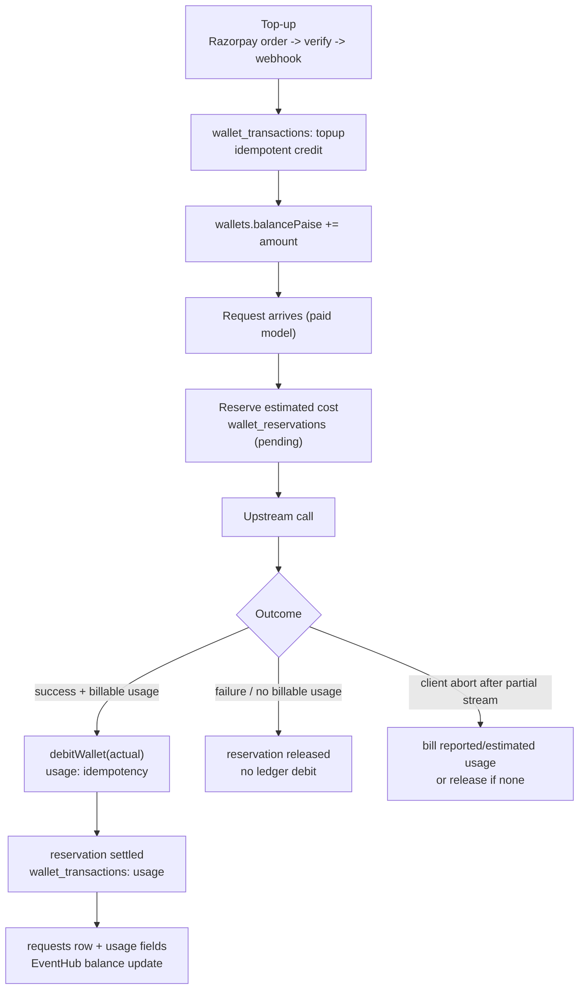

# 09 — Billing, Pricing, and Usage

## 1. Money representation

- All wallet amounts and per-token prices are **integer paise** (₹1 = 100 paise). No floating-point wallet arithmetic.
- `packages/shared/src/money.ts` provides formatting/conversion helpers.
- USD prices are converted to paise using a system setting; the code defaults to ₹80/USD in the pricing engine but seeds ₹97/USD in production (see §6).

## 2. Wallet lifecycle



Rules observed:

- Balance cannot go negative: debits are conditional atomic updates.
- Every debit/credit writes a `wallet_transactions` row with `balanceAfterPaise`, `reference`, and an `idempotencyKey`, preventing duplicate charges on retries.
- Reservations (`wallet_reservations`) hold estimated funds while streaming; settlement uses the actual token count.
- Admin wallet adjustments use the same ledger types (`adjustment`).

## 3. Pricing formula

From `packages/shared/src/pricing-engine.ts` and the catalog pricing endpoint:

```
customer_price = ceil( (upstream_cost × (1 + operational_reserve)) / (1 − target_gross_margin) )
```

Defaults:

| Parameter | Value |
|---|---|
| `operationalReserve` | 0.10 (10%) |
| `targetGrossMargin` | 0.30 (30%) |
| Minimum customer price | $0.05 (per 1M) |
| Maximum margin | 85% |
| Cached input price | 50% of input price |

`calculateTokenPrice` returns a breakdown (upstream, reserve, margin, customer) in USD, then `usdCentsToPaise`/conversion helpers produce integer paise at the configured rate. The public pricing endpoint exposes the formula string and per-model USD values.

## 4. Pricing tiers

`PRICING_TIER_SEEDS` (`packages/database/src/catalog-aliases.ts`), in USD cents per 1M tokens:

| Tier | Input | Output | Cached input |
|---|---|---|---|
| lite | 20 | 80 | 10 |
| flash | 30 | 120 | 15 |
| standard | 50 | 200 | 25 |
| code | 75 | 300 | 38 |
| reason | 100 | 400 | 50 |
| expert | higher (truncated in read) | higher | higher |

Generated profiles are assigned a tier and `pricingStatus: "approved"`. The 300 “Pro aliases” (`PRO_ALIASES`, 30 families × 10 variants) share context-window/max-output constants and route to a single upstream model id per `PRO_ALIAS_UPSTREAM_MODEL_ID`.

## 5. Usage accounting

- `requests` rows carry `usage_source`: `upstream`, `estimated`, or `none`.
- Billing applies only when `usageSource === "upstream"` **or** `BILL_ESTIMATED_USAGE` is enabled and tokens are non-zero.
- Free models (`isFree`) never debit the wallet.
- `x-prorouter-usage-source` exposes the source on non-streaming responses; streaming includes it in the final `uno` chunk.
- `requests.costPaise` stores the charged amount; dashboards aggregate from this column.
- API-key-level `spendPaise` and `spendingLimitPaise` are enforced before/around requests.
- Promotional activations track token milestones for Astra campaigns and update on finalize.

## 6. Currency and rate inconsistencies

| Source | Value | Used for |
|---|---|---|
| `seed.ts` production | `USD_TO_INR_RATE = 97` | Server-side conversions in production |
| `seed.ts` non-production | `USD_TO_INR_RATE = 80` (env override) | Local/dev |
| `seed.ts` | `USD_TO_INR_MARKET_RATE = 88` | Market/reference display |
| `pricing-engine.ts` | default rate ₹80 | Catalog price generation |

Impact: the same model can display different INR prices on different pages, and the conversion applied to top-ups/charges may differ from the displayed conversion. This should be unified behind a single setting. Status: **PARTIALLY IMPLEMENTED**.

## 7. Promotions and free access

- **48-hour launch promotion:** only two canonical models are free (`prorouter/deepseek-v4.1-flash`, `groq/qwen3.8-27b`). `promotions.launch-48h` endpoints activate entitlement; `resolvePromotionalCanonicalId` maps aliases to the promo family.
- **Astra campaign:** gift codes, referrals, entitlements, token-milestone rewards (`astra_campaigns`, `gift_codes`, `gift_code_redemptions`, `astra_entitlements`, `promotional_activations`).
- **Free quota:** `free_usage` rows track minute/hour/day buckets with atomic upserts. Exceeding a bucket returns a quota error.
- **Queue priority:** free-model requests draw priority from `plans.queue_priority`; wait time is reported as `queueWaitMs`.

## 8. Payments

| Gateway | Flow | Verification |
|---|---|---|
| Razorpay | `POST /wallet/checkout` creates order → client pays → `POST /wallet/verify` → webhook | HMAC signature check; payment row status update; idempotent credit |
| Stripe | Webhook (`paymentWebhooks`) | Signature verification; event id recorded |

Credit packages can include `bonusPaise`; the ledger records top-up and bonus separately in metadata.

## 9. Billing status

| Capability | Status |
|---|---|
| Integer paise wallet + immutable ledger | FULLY IMPLEMENTED |
| Idempotent credits/debits | FULLY IMPLEMENTED |
| Reservations for streaming | FULLY IMPLEMENTED |
| Tier-based pricing | FULLY IMPLEMENTED |
| Multi-rate INR consistency | PARTIALLY IMPLEMENTED |
| Usage-based billing when upstream omits usage | CONFIGURED BUT NOT CONNECTED (`BILL_ESTIMATED_USAGE` default false) |
| Dunning/subscription renewal | NOT IMPLEMENTED (plans/subscriptions exist; no renewal job found) |
| Refund automation | NOT IMPLEMENTED (manual/admin only) |
| Invoice generation | NOT IMPLEMENTED |
| Tax/GST handling | NOT IMPLEMENTED |
