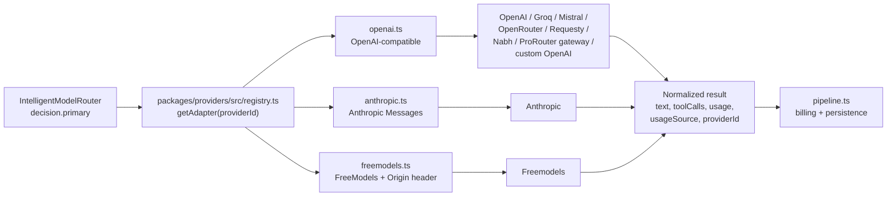

# 10 — Provider Integrations

## 1. Adapter architecture

- `adapter.ts` defines the provider contract: non-streaming `chat`, streaming `streamChat`, and normalized stream events (`content`, `tool_call_delta`, `usage`, completion).
- `registry.ts` maps provider ids/slugs to adapters and base URLs; adapters are constructed with decrypted credentials.
- `openai.ts` is the workhorse: any OpenAI-compatible `/chat/completions` endpoint can be driven by base URL + API key.
- `anthropic.ts` translates OpenAI-style messages/tools to Anthropic Messages semantics and maps stream events back.
- `freemodels.ts` adds the required `Origin: https://freemodels.pro` header.

## 2. Configured providers (env names only; values redacted)

| Provider | Env vars | Base URL (verified where present) |
|---|---|---|
| OpenAI | `OPENAI_API_KEY` | api.openai.com |
| Anthropic | `ANTHROPIC_API_KEY` | api.anthropic.com |
| Google | `GOOGLE_API_KEY` / Gemini key | Google endpoint (implementation NEEDS VERIFICATION) |
| Groq | `GROQ_API_KEY` | Groq OpenAI-compatible endpoint |
| Mistral | `MISTRAL_API_KEY` | Mistral OpenAI-compatible endpoint |
| OpenRouter | `PROVIDER_OPENROUTER_API_KEY` | openrouter.ai |
| Custom OpenAI | `PROVIDER_CUSTOM_OPENAI_*` | configurable |
| ProRouter gateway | `PROVIDER_PROROUTER_GATEWAY_*` | `https://gpt-code-p2mf.onrender.com/v1` |
| Requesty | `PROVIDER_REQUESTY_*` | `https://router.requesty.ai/v1` |
| Nabh | `PROVIDER_NABH_*` (or key pool in web gateway) | Nabh endpoint |
| Freemodels | FreeModels credentials | FreeModels endpoint (`Origin` required) |
| TokenJuice | web gateway built-in pool | **NEEDS VERIFICATION** |

Provider credentials are stored encrypted in `provider_credentials`; admins can create/update them via `PUT /admin/providers/:id/credential`. The API never returns decrypted values in DTOs.

## 3. Provider/model linkage

- `model_providers` links a customer-facing model to one or more providers with an `upstreamModelId` and priority.
- The routing registry additionally hardcodes backend ids and costs (`backend-registry.ts`).
- `provider_costs` stores upstream price rows; `pricing_versions`/`pricing_audit_logs` track customer price changes.
- `model_aliases` and `PRO_ALIASES` map friendly names to canonical/upstream ids.

## 4. Health and readiness

- `provider_health` stores status, last check, latency, and error.
- Admin endpoints: `GET /admin/providers`, `POST /admin/providers/:id/check`, `GET /admin/model-health`.
- The router's `ProviderHealthMonitor` provides in-process circuit breaking with cooldowns.
- Suspected defect: `isAvailable(id)` keying mismatch versus `getOrCreate(provider, backendId)` — **NEEDS VERIFICATION**.

## 5. Error normalization

Adapters map upstream failures to internal `ApiError` codes so the fallback manager can decide:

| Upstream condition | Internal handling |
|---|---|
| 401/403 | Provider auth error; backend likely marked unhealthy |
| 429 | Rate limit; fallback eligible |
| 400 context length | Surface to client (no retry if request-specific) |
| 5xx / timeout | Retry/fallback eligible |
| Stream abort | Propagate as `abort_error` after tokens; no replay |
| Safety refusal | Preserve refusal; do not route around it |

## 6. Capability coverage

| Capability | Support |
|---|---|
| Chat completions (stream + non-stream) | Yes across adapters |
| Tool calling | Pass-through; support varies by upstream |
| JSON/structured output | Pass-through where provider supports it |
| Vision | Pass-through when the upstream model supports image parts |
| Embeddings | NOT IMPLEMENTED (no adapter path found) |
| Image/audio generation | NOT IMPLEMENTED |
| Rerank | NOT IMPLEMENTED |
| Provider-native prompt caching | Not explicitly managed; cached token prices exist in pricing |
| Batch APIs | NOT IMPLEMENTED |

## 7. Provider-specific risks

1. **Static registry drift.** `backend-registry.ts` hardcodes models/costs; upstream catalogs can change without code changes here. Price sync endpoints exist but their scheduler is not evident.
2. **Single upstream concentration.** Many display models converge on `prorouter/deepseek-v4.1-flash` (and a few Groq/Requesty/Nemotron backends). A single upstream outage degrades most of the catalog.
3. **Demo-mode credentials.** The web gateway's built-in pools are separate from `provider_credentials` and may bypass admin controls/rotation.
4. **Anthropic translation fidelity.** Tool and system-message mappings are adapter-specific; edge cases (multi-part content, parallel tool calls) need contract tests.
5. **Health key mismatch** could cause the router to ignore real outages or block healthy backends.

## 8. Status

| Area | Status |
|---|---|
| OpenAI-compatible adapter | FULLY IMPLEMENTED |
| Anthropic adapter | PARTIALLY IMPLEMENTED (translation edge cases unverified) |
| Freemodels adapter | FULLY IMPLEMENTED (header requirement handled) |
| Provider CRUD + encrypted credentials | FULLY IMPLEMENTED |
| Health checks + circuit breaking | PARTIALLY IMPLEMENTED (key mismatch suspected) |
| Automated provider catalog/price sync | PARTIALLY IMPLEMENTED (admin endpoints; scheduler not found) |
| Non-chat modalities | NOT IMPLEMENTED |
