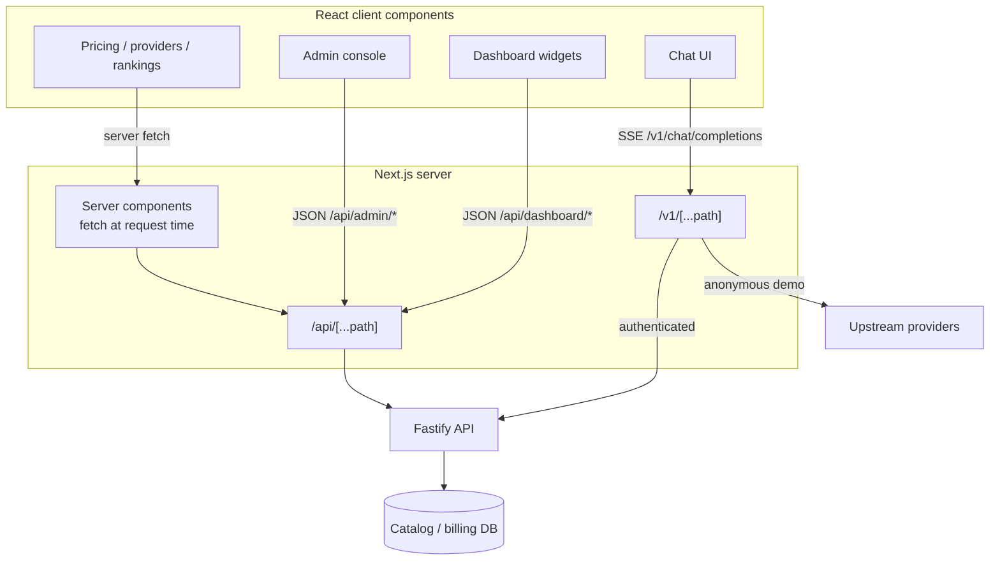

# 11 — Frontend Application (`apps/web`)

## 1. Stack and structure

- **Next.js 16 App Router**, React 19, Tailwind CSS 4, TypeScript.
- Server components for marketing/catalog data; client components for chat, dashboard interactions, and admin forms.
- Two custom BFF routes:
  - `app/api/[...path]/route.ts` — proxy to the Fastify API with timeout, failure cooldown, and builtin fallback.
  - `app/v1/[...path]/route.ts` — OpenAI-compatible gateway with backend and demo modes.

## 2. Page inventory (verified by glob)

**Marketing/public**
- `/` (`app/page.tsx`)
- `/pricing` (+ `PricingContent` client component)
- `/providers`, `/rankings`, `/docs`, `/changelog`, `/status`
- `/security`, `/terms`, `/privacy`, `/refund`
- `/redeem`

**Auth**
- `/login`, `/signup`

**Product**
- `/chat`
- `/dashboard` (overview)
- `/dashboard/wallet`
- `/dashboard/usage`
- `/dashboard/activity`
- `/dashboard/inspector`
- `/dashboard/astra`
- `/dashboard/admin`
- `/dashboard/text/usage`
- `/dashboard/text/fair-use`
- `/dashboard/text/plans`
- `/dashboard/text/checkout`
- `/admin`

## 3. Data flow

- The chat UI streams from `/v1/chat/completions`, rendering incremental deltas and tool-call events.
- Dashboard pages poll or fetch summary endpoints (`/dashboard/overview`, `/dashboard/series`, `/dashboard/activity`, `/dashboard/usage`) and may subscribe to `/dashboard/events` SSE for live balance/usage updates.
- Admin screens call `/admin/*` through the proxy; credential writes send secrets to the API for encryption.

## 4. Chat experience

Verified by API contract and page presence; component-level behavior is **PARTIALLY VERIFIED**:

- Model picker driven by `/v1/models`/catalog data, including free/promo badges.
- Streaming rendering of content and tool-call deltas.
- Request metadata (`uno`) available for showing provider, cost, and routing trace.
- Conversation persistence via `conversations`/`messages` tables exists in the schema; the exact UI wiring was not fully read — **NEEDS VERIFICATION**.
- Free-playground limit and anonymous demo behavior are server-side in the `/v1` gateway, not purely UI.

## 5. Proxy and resilience behavior

`app/api/[...path]/route.ts`:

- Forwards method, body, cookies, and safe headers to `${API_BASE_URL}${path}`.
- Skips proxying when `API_BASE_URL` points at localhost to avoid self-loops.
- `PROXY_TIMEOUT_MS = 2500`; after a backend failure, `BACKEND_FAILURE_COOLDOWN_MS = 45000` avoids hammering a dead API.
- On failure/timeout, invokes `handleFallback` from `lib/builtin-gateway.ts` so catalog/demo pages still render.
- This fallback is for availability, not billing; authenticated mutations should not silently succeed through it.

## 6. Demo gateway (risk surface)

`app/v1/[...path]/route.ts` (≈3,350 lines) is effectively a second API implementation:

- Backend mode when an API key or session cookie is present.
- Local/demo mode otherwise, using server-side provider key pools (TokenJuice, Requesty, Nabh, FreeModels).
- In-memory anonymous cap: 10 requests/day (not durable across instances/restarts).
- Static model list (`ALL_MODELS`, 61 entries plus `ALL_MODELS_500`).
- Several unused constants/maps (`FREEMODELS_TIERED_MODELS`, `REQUESTY_MODELS_MAP`) indicate drift.
- `maxDuration = 60` for serverless streaming.

Security and billing implications are detailed in doc 08.

## 7. UX/status observations

| Area | Observation | Status |
|---|---|---|
| Marketing pages | Present; pricing data comes from API/catalog | FULLY IMPLEMENTED (content depth varies) |
| Auth pages | Present; rely on backend validation | FULLY IMPLEMENTED |
| Chat streaming | Implemented; tool-call rendering needs manual QA | PARTIALLY IMPLEMENTED |
| Dashboard analytics | Endpoints and pages present | PARTIALLY IMPLEMENTED (page internals not fully reviewed) |
| Admin console | Broad endpoint coverage; UI depth unverified | PARTIALLY IMPLEMENTED |
| Mobile responsiveness | Tailwind 4 responsive classes expected; no dedicated audit | NEEDS VERIFICATION |
| Accessibility | No audit artifacts found | NEEDS VERIFICATION |
| Error/empty states | Proxy fallback exists; per-page states unverified | PARTIALLY IMPLEMENTED |

## 8. Frontend-specific risks

1. **Split-brain API behavior.** `/api` proxies to Fastify while `/v1` may serve demo responses locally; users can see different catalogs/prices depending on route and auth state.
2. **Server-held credentials in the web tier** broaden the attack surface and complicate key rotation.
3. **Static `ALL_MODELS` list** can drift from the database catalog and routing registry.
4. **Proxy fallback masking outages.** `handleFallback` may return plausible model data during backend downtime, which can hide incidents from users and operators.
5. **Dashboard admin gating** depends on the API; there is no separate frontend role check worth relying on.
