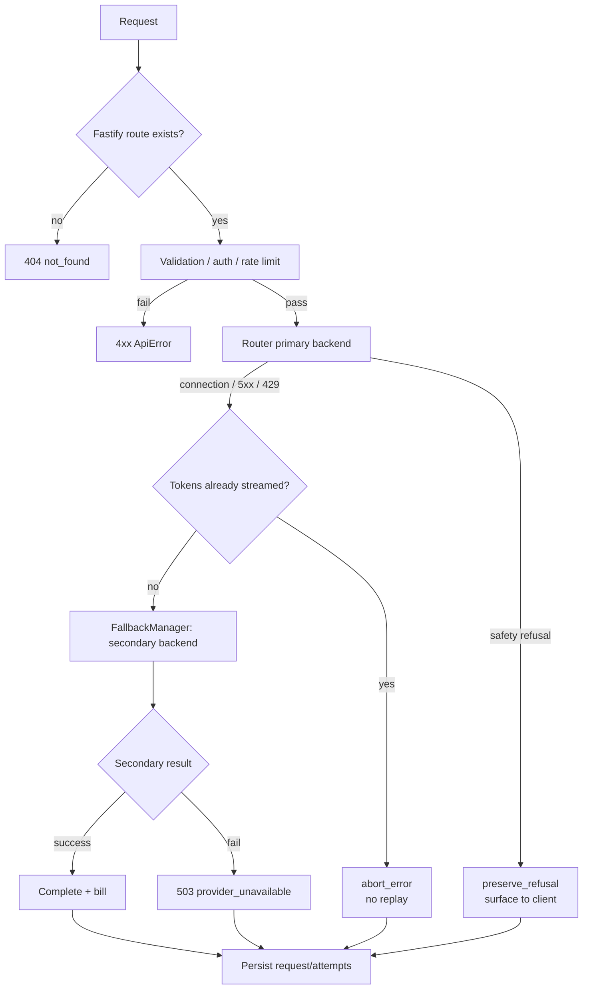

# 12 — Error Handling and Failover

## 1. Error envelope

`packages/shared/src/errors.ts` defines `ApiError` with a code, HTTP status, and optional details. The Fastify error handler renders an OpenAI-compatible body:

```json
{
  "error": {
    "message": "Human-readable description",
    "type": "invalid_request_error | authentication_error | rate_limit_error | provider_error | server_error",
    "code": "machine_readable_code",
    "param": "optional field"
  }
}
```

`ApiError.toBody(requestId)` is used inside streaming paths to emit the same shape mid-stream. Request ids appear in logs and `uno` metadata.

## 2. Failover layers



### 2.1 Provider-level retry

- The fallback manager tries the secondary backend when the primary fails before producing tokens.
- Retry eligibility depends on error class: auth failures and request-specific 400s are not retried; 429/5xx/timeouts are.
- Each attempt is recorded in `request_attempts` (provider, backend, latency, error).
- Cost accounting uses the backend that actually served the response (`outcomeProviderId`).

### 2.2 Stream-level safety

- Once tokens have been sent, replaying on another backend would duplicate content. The router aborts with `abort_error` instead.
- Client disconnects abort the upstream (`request.signal`) and finalize as `client_aborted` (HTTP 499 in analytics).
- Mid-stream errors are delivered as a final `data: {"error": {...}}` event plus `[DONE]`.

### 2.3 Web proxy failover

`apps/web/app/api/[...path]/route.ts`:

- 2.5 s upstream timeout.
- On failure, a 45 s cooldown prevents repeated attempts to a dead backend.
- Falls back to `lib/builtin-gateway.ts`, which returns built-in model/catalog/demo responses.
- This layer is availability-oriented; it does not re-authenticate or re-bill.

### 2.4 Demo gateway failover

The Next.js `/v1` gateway can call multiple provider pools (TokenJuice/Requesty/Nabh/FreeModels) with `fetchGatewayWithRetry` and a header-bounded fetch wrapper (timeout/abort). Behavior is independent of the Fastify fallback manager and is **PARTIALLY VERIFIED**.

## 3. Error taxonomy observed

| Domain | Examples | HTTP |
|---|---|---|
| Validation | malformed JSON, bad `messages`, invalid model | 400 |
| Auth | missing/invalid session or API key, revoked key, expired key | 401 |
| Authorization | non-admin calling admin; key model restriction | 403 |
| Not found | unknown model/provider/request/key | 404 |
| Policy | pricing_pending model, Gmail-only registration, quota exhausted | 400/403/429 |
| Rate limit | IP/user/key windows | 429 + `Retry-After` |
| Wallet | insufficient balance, reservation conflict | 402/400 |
| Provider | upstream 4xx/5xx, timeout, malformed stream | 502/503 |
| Server | unhandled exception | 500 |

## 4. Circuit breaking and health

- `ProviderHealthMonitor` marks failures and applies cooldowns.
- `provider_health` persists the latest status for admin display.
- Suspected key mismatch (`provider:backend` vs bare backend id) may prevent health signals from affecting routing decisions. **NEEDS VERIFICATION.**
- No global circuit breaker exists for the database or payment gateway.

## 5. Retry/idempotency interactions

- Billing operations are idempotent (`usage:<requestId>`, payment ids), so retries do not double-charge.
- Provider retries after a request has been partially processed risk duplicate upstream spend even if the client is billed once; there is no distributed lock preventing concurrent duplicate attempts for the same client request id.
- Webhook processing relies on `payment_webhooks` event ids to deduplicate.

## 6. Gaps

| Gap | Impact | Status |
|---|---|---|
| No dead-letter queue for failed persistence | Lost analytics rows on crash | NOT IMPLEMENTED |
| No jittered exponential backoff across providers | Thundering herd on recovery | PARTIALLY IMPLEMENTED |
| Fallback can mask backend outages in the web UI | Operators may miss incidents | PARTIALLY IMPLEMENTED |
| Health key mismatch | Wrong routing decisions | NEEDS VERIFICATION |
| No idempotency key at the chat endpoint for client retries | Duplicate requests/charges for the same logical call (each gets a new request id) | NOT IMPLEMENTED |
| Stream replay protection | Abort instead of transparent resume | PARTIALLY IMPLEMENTED (safe but degraded) |
| Error messages may leak upstream details | Information disclosure | NEEDS VERIFICATION |

## 7. Status summary

| Capability | Status |
|---|---|
| OpenAI-style error envelope | FULLY IMPLEMENTED |
| Multi-backend failover | FULLY IMPLEMENTED (pre-token) |
| Mid-stream abort safety | FULLY IMPLEMENTED |
| Health-aware circuit breaking | PARTIALLY IMPLEMENTED |
| Proxy cooldown + builtin fallback | FULLY IMPLEMENTED |
| Durable retry/queue | NOT IMPLEMENTED |
| Client-request idempotency | NOT IMPLEMENTED |
